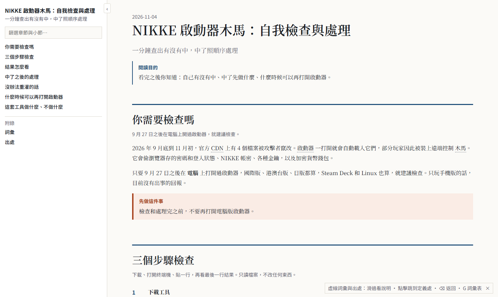
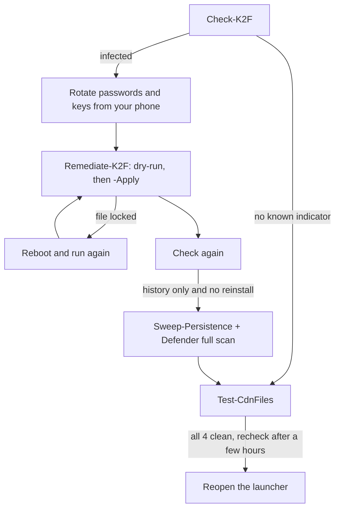

<div align="center">

# nikke-k2f-check

**Find out in a minute whether the NIKKE PC launcher malware got you, and what to do in which order.**

English · [中文](README.md)

   

[Player guide (zh-TW)](https://wizerdbache.github.io/nikke-k2f-check/) · [Quick start](#quick-start) · [Reading the verdict](#reading-the-verdict) · [Facts and sources](docs/FACTS.md) · [Developer doc](docs/DEVELOPER.md) · [For AI agents](AGENTS.md)



</div>

*Image labels are in Traditional Chinese; the player guide is written for Traditional Chinese readers.*

## What happened

From 2026-09-27, four JavaScript files on Level Infinite's CDN were tampered with. The NIKKE PC launcher loads them on start, and some players got a remote-access trojan (K2F) that steals browser passwords and cookies, the saved NIKKE login, SSH and API keys, crypto wallets, and can run any command. The publisher announced a fix on 2026-11-04, but **a PC that was already infected does not become clean by updating**.

## What you get

| Script | Does | Changes anything? |
|---|---|---|
| `Check-K2F.ps1` | Stage 1 (launcher) and stage 2 (Chrome persistence, other Chromium browsers too) indicators for every user profile on the PC, agent timeline, "live components" vs "history only" | Read-only |
| `Remediate-K2F.ps1` | Stops the launcher, removes the Chrome backdoor, quarantines the launcher cache, blocks domains and IPs | Dry-run by default; `-Apply` acts, moving everything to a quarantine folder (no deletes) |
| `Sweep-Persistence.ps1` | For people who cannot reinstall: autostart points and unsigned files created inside the agent's real active windows | Read-only |
| `Test-CdnFiles.ps1` | Compares the 4 CDN files' ETags with the known-clean ones before you reopen the launcher | HEAD requests only |

## Quick start

1. **Code → Download ZIP**, extract into Downloads.
2. Right-click Start → Terminal, paste:

```powershell
powershell -ExecutionPolicy Bypass -File "$HOME\Downloads\nikke-k2f-check-main\Check-K2F.ps1"
```

3. If infected, **change passwords from your phone first**, then in an elevated terminal dry-run, read, apply:

```powershell
powershell -ExecutionPolicy Bypass -File "$HOME\Downloads\nikke-k2f-check-main\Remediate-K2F.ps1"
```

```powershell
powershell -ExecutionPolicy Bypass -File "$HOME\Downloads\nikke-k2f-check-main\Remediate-K2F.ps1" -Apply
```

Paste this to an AI coding agent:

```text
Read AGENTS.md in this repo. Run Check-K2F.ps1 read-only and explain the verdict to me.
Do not run Remediate-K2F.ps1 with -Apply without asking me first.
```

## Flow



## Reading the verdict

| Last line | Meaning |
|---|---|
| 中毒，木馬元件仍在 (infected, live) | The agent ran and its components are still present |
| 曾經中毒，只剩歷史紀錄 (infected, history only) | The agent ran; known components are gone; stolen credentials are still valid |
| 有接觸，未見木馬啟動 (contact) | The launcher loaded the attacker's script; no agent start seen |
| 沒發現已知痕跡 (none known) | No known indicator; not a guarantee |

## Differences from the popular one-liner

- leveldb and Code Cache are binary; `Select-String` missed `k2f.agent.state` on a real infected PC. These scripts search bytes (ASCII and UTF-16LE).
- Live components and history are separated, so a cleaned PC does not read "infected" forever.
- Remediation quarantines, never deletes, and never matches processes on an empty path prefix.
- No `irm ... | iex` remote one-liner: remote code loading is exactly what went wrong here.

## You want... read...

| You want | Read |
|---|---|
| Step-by-step check and fix | [Player guide](https://wizerdbache.github.io/nikke-k2f-check/) |
| The source of every indicator | [docs/FACTS.md](docs/FACTS.md) |
| How verdicts are decided, verification, limits | [docs/DEVELOPER.md](docs/DEVELOPER.md) |
| Let an AI agent run it | [AGENTS.md](AGENTS.md) |

## Limits

- Known indicators only; the RAT could run arbitrary commands, so a reinstall remains the safest option.
- Stage 2 (HKCU, `%LOCALAPPDATA%`) is only reliable from your own PowerShell window; some sandboxed app terminals virtualize those locations.
- Windows Defender may flag the downloaded ZIP (usually a `!ml` machine-learning name such as `Trojan:Script/Wacatac.B!ml`). The code is public for inspection; do not turn off your antivirus for it, report the false positive through Microsoft's file submission page instead. See [docs/FACTS.md](docs/FACTS.md#防毒誤報).
- Not an official tool. Details: [docs/DEVELOPER.md](docs/DEVELOPER.md#限制).

## Credits

[MotherSphere analysis](https://gist.github.com/MotherSphere/d6c049a09ba8ac3085c51ee9df24a4e5) · [WormW sample analysis](https://github.com/WormW/nikke_malware_analysis) · [Bahamut write-up](https://m.gamer.com.tw/forum/C.php?bsn=36390&snA=23304)

## Author

[WizerdBaChe](https://github.com/WizerdBaChe) · [wizerdbache.com](https://wizerdbache.com/) · [YouTube](https://www.youtube.com/@wizerdbache) · [Threads](https://www.threads.com/@wizerd.bache)

## License

[MIT](LICENSE)
