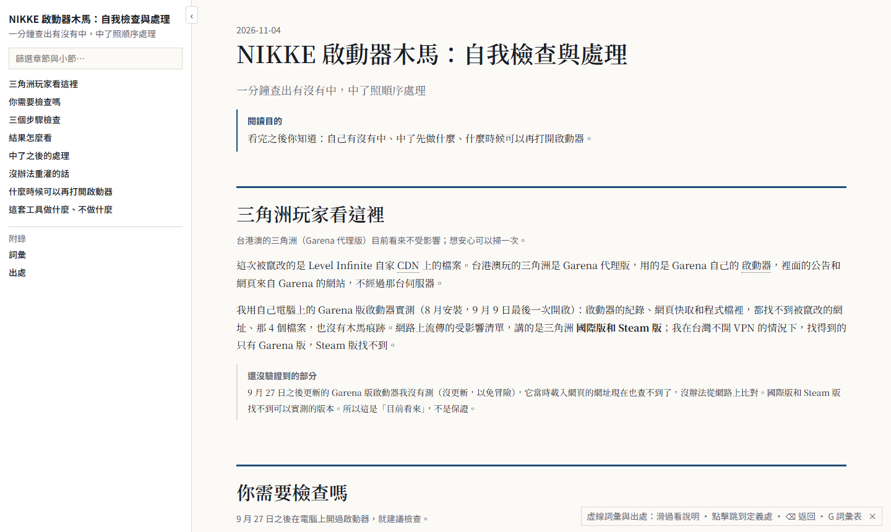
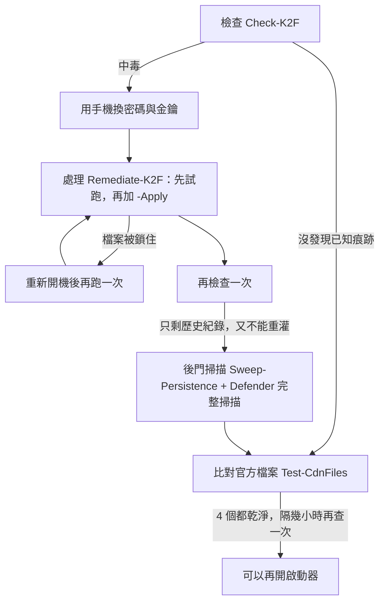

<div align="center">

# nikke-k2f-check

**一分鐘查出電腦版《勝利女神：妮姬》啟動器木馬有沒有中，中了照順序處理。**

[English](README.en.md) · 中文

   

[玩家說明頁](https://wizerdbache.github.io/nikke-k2f-check/) · [快速開始](#快速開始) · [結果怎麼看](#結果怎麼看) · [事實清單](docs/FACTS.md) · [開發文件](docs/DEVELOPER.md) · [給 AI 代理](AGENTS.md)



</div>

## 三角洲玩家看這裡

> **台港澳的三角洲（Garena 代理版）目前看來不受這次事件影響**，想安心可以照[快速開始](#快速開始)掃一次，工具會自動找到 Garena 版。

- 這次被竄改的是 Level Infinite 自家伺服器上的檔案。Garena 版用的是 Garena 自己的啟動器，網頁內容來自 Garena 的網站，不經過那台伺服器。
- 作者實測自己電腦上的 Garena 版啟動器（8 月安裝，最後開啟 9/9）：啟動器紀錄、網頁快取、程式檔都找不到被竄改的網址、那 4 個檔案或木馬痕跡。
- 網路上流傳的受影響清單講的是三角洲**國際版／Steam 版**。作者在台灣不開 VPN 的情況下，找得到的只有 Garena 版，Steam 版找不到。
- 沒驗證到的部分：Garena 版 9/27 之後的新版啟動器（作者沒更新，以免冒險；它當時載入網頁的網址現在已經查不到，沒辦法從網路比對）；國際版與 Steam 版找不到可以實測的版本。

## 發生了什麼

2026 年 9 月 27 日起，官方 CDN 上 4 個 JS 檔被竄改。電腦版啟動器一打開就會載入它們，部分玩家因此被裝上遠端控制木馬（K2F）。木馬會偷瀏覽器密碼與登入狀態、NIKKE 帳密、SSH 與 API 金鑰、加密貨幣錢包，還能執行任意指令。官方 11/4 公告已經修復，但**已經中毒的電腦不會因為更新就變乾淨**。

## 你會拿到什麼

| 腳本 | 做什麼 | 會不會改東西 |
|---|---|---|
| `Check-K2F.ps1` | 查第 1 階段（啟動器）和第 2 階段（Chrome 常駐，也查其他 Chromium 瀏覽器）的痕跡，涵蓋這台電腦每個使用者帳號；列出木馬活動時間線，並分出「元件仍在」和「只剩歷史紀錄」 | 只讀 |
| `Remediate-K2F.ps1` | 結束啟動器、移除 Chrome 後門、隔離啟動器快取、封鎖網域與 IP | 預設試跑；加 `-Apply` 才動手，一律搬到隔離資料夾，不刪除 |
| `Sweep-Persistence.ps1` | 給沒辦法重灌的人：從啟動器紀錄算出木馬真正活動的時段，列出那段時間新增的自動啟動項和未簽章程式 | 只讀 |
| `Test-CdnFiles.ps1` | 比對官方 CDN 上 4 個檔案的指紋（ETag），判斷能不能再開啟動器 | 只送 HEAD 請求，不下載 |

## 快速開始

1. 按 **Code → Download ZIP**，解壓到「下載」資料夾。
2. 在開始按鈕上按右鍵 →「終端機」，貼上：

```powershell
powershell -ExecutionPolicy Bypass -File "$HOME\Downloads\nikke-k2f-check-main\Check-K2F.ps1"
```

3. 中了的話，**先用手機改密碼**，再打開「終端機（系統管理員）」，先試跑、確認清單，再執行處理：

```powershell
powershell -ExecutionPolicy Bypass -File "$HOME\Downloads\nikke-k2f-check-main\Remediate-K2F.ps1"
```

```powershell
powershell -ExecutionPolicy Bypass -File "$HOME\Downloads\nikke-k2f-check-main\Remediate-K2F.ps1" -Apply
```

讓 AI 代理（Claude Code、Codex 等）幫你跑，可以貼這段給它：

```text
Read AGENTS.md in this repo. Run Check-K2F.ps1 read-only and explain the verdict to me.
Do not run Remediate-K2F.ps1 with -Apply without asking me first.
```

完整步驟、結果判讀、換密碼的順序，請看[玩家說明頁](https://wizerdbache.github.io/nikke-k2f-check/)。

## 流程



## 結果怎麼看

| 最後一行顯示 | 意思 |
|---|---|
| 中毒，木馬元件仍在 | 木馬啟動過，元件還在電腦裡 |
| 曾經中毒，只剩歷史紀錄 | 木馬啟動過，已知元件已清除；但被偷的憑證仍然有效 |
| 有接觸，未見木馬啟動 | 啟動器載入過攻擊者的腳本，但沒看到木馬啟動 |
| 沒發現已知痕跡 | 已知痕跡都沒出現，不等於百分之百安全 |

## 跟網路上一鍵檢查的差別

- 啟動器快取裡的 leveldb 和 Code Cache 是二進位檔。常見一鍵檢查用的 `Select-String` 會漏抓木馬的狀態紀錄 `k2f.agent.state`（在一台中毒的電腦上實測過）；這裡改用位元組比對。
- 分出「元件仍在」和「只剩歷史紀錄」，處理完重跑，不會永遠顯示中毒。
- 處理一律搬到隔離資料夾，不刪除；找不到安裝路徑時，也不會誤把所有程序都當成啟動器結束掉。
- 不提供 `irm ... | iex` 這類「直接從網路下載並執行」的指令：這次事件，出事的正是自動載入遠端程式碼。

## 你想要…看哪裡

| 你想要 | 看 |
|---|---|
| 照步驟檢查、處理 | [玩家說明頁](https://wizerdbache.github.io/nikke-k2f-check/) |
| 每一條痕跡的來源 | [docs/FACTS.md](docs/FACTS.md) |
| 腳本怎麼判定、怎麼驗證、有哪些限制 | [docs/DEVELOPER.md](docs/DEVELOPER.md) |
| 讓 AI 代理幫你跑 | [AGENTS.md](AGENTS.md) |

## 限制

- 只能找**已知**痕跡。木馬能執行任意指令，最保險的做法仍是重灌。
- **其他遊戲**：網路上說三角洲國際版／Steam 版、PUBG、王者榮耀國際版等 Level Infinite 遊戲也中了，目前**沒有證實**。台港澳三角洲 Garena 版見[三角洲玩家看這裡](#三角洲玩家看這裡)。其他遊戲要用 `-InstallPath` 指定啟動器資料夾。詳見 [docs/FACTS.md](docs/FACTS.md#其他遊戲未證實)。
- 第 2 階段（HKCU 登錄檔、`%LOCALAPPDATA%`）要在你自己開的 PowerShell 視窗跑才準；在某些沙箱化 App 的內建終端機裡，這兩處可能被虛擬化。
- Windows Defender 可能把下載的 ZIP 誤報成病毒（名稱常帶 `!ml`）。程式全部公開可檢查，請不要為此關掉防毒；可到微軟的檔案提交頁面回報誤判。詳見 [docs/FACTS.md](docs/FACTS.md#防毒誤報)。
- 這不是官方工具，痕跡清單會跟著原始研究更新。詳見 [docs/DEVELOPER.md](docs/DEVELOPER.md#限制)。

## 致謝與來源

[MotherSphere 技術整理](https://gist.github.com/MotherSphere/d6c049a09ba8ac3085c51ee9df24a4e5) · [WormW 樣本分析](https://github.com/WormW/nikke_malware_analysis) · [巴哈姆特整理文](https://m.gamer.com.tw/forum/C.php?bsn=36390&snA=23304)

## 作者

[WizerdBaChe](https://github.com/WizerdBaChe) · [wizerdbache.com](https://wizerdbache.com/) · [YouTube](https://www.youtube.com/@wizerdbache) · [Threads](https://www.threads.com/@wizerd.bache)

## 授權

[MIT](LICENSE)
