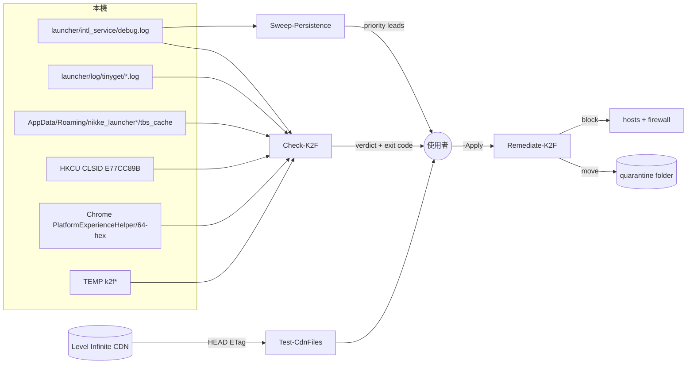

# 開發文件

給想看懂、驗證或修改這套腳本的人。所有痕跡與數值的來源在 [FACTS.md](FACTS.md)。

## 結構

```text
nikke-k2f-check/
├── Check-K2F.ps1            只讀偵測：第 1／2 階段痕跡、時間線、判定
├── Remediate-K2F.ps1        處置：預設試跑，-Apply 才動手，一律隔離不刪
├── Sweep-Persistence.ps1    只讀：木馬活動時段內新增的自動啟動項與未簽章檔案
├── Test-CdnFiles.ps1        只送 HEAD：比對 4 個 CDN 檔案的 ETag
├── README.md / README.en.md
├── AGENTS.md                給 AI 代理的事實與步驟
├── llms.txt                 機器索引
├── tests/
│   └── Run-FixtureTests.ps1 假資料夾測試：每個檢查各一個正向、一個負向案例
└── docs/
    ├── FACTS.md             事實清單（單一來源）
    ├── DEVELOPER.md         本文件
    ├── index.explainer.json 玩家說明頁的內容檔
    ├── index.html           由內容檔產生的說明頁（GitHub Pages）
    └── assets/
        ├── build_hero.py    重新產生 hero.png
        └── hero.png
```

## 資料流



## 判定邏輯

`Check-K2F.ps1`：

| 判定 | 條件 | exit code |
|---|---|---|
| infected-live | 有 RED，且至少一筆不在 `debug.log` / `tinyget` 底下（元件仍在） | 3 |
| infected-history | RED 全部只在 `debug.log` / `tinyget` / 啟動器網路紀錄 `TransportSecurity`、`Network Persistent State`（都是過去的紀錄，不是元件） | 2 |
| contact | 只有 YELLOW | 1 |
| clean-known | 沒有任何發現 | 0 |

- 字串比對一律讀位元組（Latin-1 一對一解碼），同時比 ASCII 與 UTF-16LE。原因：leveldb 與 Code Cache 是二進位檔，`Select-String` 在實測機上漏抓 `k2f.agent.state`。
- 檢查範圍是目前使用者，加上 `-UsersRoot`（預設 `C:\Users`）底下讀得到的每個使用者資料夾：啟動器快取、瀏覽器資料夾、TEMP。其他使用者的 HKCU 登錄要用那個帳號登入再跑。使用者清單的邏輯在 `Check-K2F.ps1` 第 0a 段與 `Remediate-K2F.ps1` 開頭各有一份，要一起改。
- 找安裝資料夾：`-InstallPath` → 解除安裝登錄（名稱含 NIKKE 或 Delta Force）→ URL protocol 圖示、資料夾裡的 `url_protocol.reg` 或資料夾旁的 `<資料夾名>.reg` → 都找不到真的啟動器時，才搜各磁碟前三層名稱含 NIKKE 或 Delta Force 的資料夾。
- 啟動器資料夾的判斷：底下有 `intl_service`（妮姬）或 `service\debug.log`（三角洲 Garena 版），本身或 `launcher\` 子資料夾都算。這段在三支腳本各有一份（Check 的 `Resolve-Launchers`、Remediate 的 `Resolve-LauncherDir`、Sweep 的 debug.log 篩選），要一起改。
- 啟動器網頁快取：`%APPDATA%` 底下名稱是 `nikke_launcher*`，或含有 `tbs_cache` 的資料夾（三角洲 Garena 版是 `df_garena_launcher`）。妮姬以外的遊戲沒有公開樣本，所以 `Remediate` 只在這類快取裡找到 `insightjs` 或 `k2f.agent.state` 時才隔離；妮姬的快取一律隔離。
- hosts：任何沒被註解、把網域指到 `0.0.0.0`、`127.0.0.1`、`::1`、`::` 的行都算封鎖。防火牆：規則要啟用、連出、封鎖，而且涵蓋兩個 IP 才算；`Remediate` 發現同名規則內容不對會重建。
- `agent_pass` 不會印出，也不寫進報告。

`Sweep-Persistence.ps1` 的木馬活動時段：從每筆 `agent started as` 起算，到那次啟動器最後一筆 `debug.log` 紀錄（間隔超過 1 小時視為下一次啟動）再加 30 分鐘，上限 `-WindowHours`（預設 8）。木馬住在啟動器的網頁元件裡，啟動器關了它就停，所以用固定 8 小時會把之後裝的正常軟體也算進去（實測：從 575 項降到 0 項優先項目）。已有效簽章的程式檔不列入。

## 驗證

在一台已知中毒的港澳台版電腦上（2026-11-04）：

| 檢查 | 結果 |
|---|---|
| 正向對照：Check-K2F 對中毒機 | 抓到 debug.log 三行、3 個 tinyget 紀錄、`k2f.agent.state`（c2s_counter=5）、Code Cache 接觸 |
| 負向對照：Check-K2F 對乾淨的假安裝資料夾（只有 `FETCH_LIST suc success`） | 安裝資料夾類發現 0 筆 |
| 處理後重跑 | 判定由 infected-live 變為 infected-history |
| Remediate 邊界：`-InstallPath C:\` 試跑 | 沒有列出任何不相關的程序 |
| Test-CdnFiles（台灣，約 15:00） | 4 個檔案都是乾淨 ETag |
| 4 支腳本 PowerShell 5.1 解析 | 0 個語法錯誤 |

2026-11-04 加入多使用者、其他瀏覽器、32 位元登錄、任意程序、啟動器網路紀錄、`url_protocol.reg` 找安裝、hosts/防火牆判讀之後：

| 檢查 | 結果 |
|---|---|
| `tests/Run-FixtureTests.ps1` 對新版 | 27 項全過 |
| 同一份測試對改版前的 `main` | 17 項失敗，全部是這次新增的檢查（對照組：測試抓得到改版前缺的東西） |
| 新版在實測機上重跑（機器已處理過） | clean-known，exit 0；防火牆規則內容核對為已封鎖 |
| HSTS 雜湊 | 自行重算三個網域，與 hamzzi 工具的常數一致 |

2026-11-04 加入三角洲 Garena 版的資料夾結構之後：

| 檢查 | 結果 |
|---|---|
| `tests/Run-FixtureTests.ps1` 對新版 | 37 項全過 |
| 新增的 P8/N8（檢查）對改版前的 `Check-K2F.ps1` | 6 項中 5 項失敗（唯一通過的是「乾淨紀錄不誤報」，舊版本來就不會報） |
| 新增的 R2（處理）對改版前的 `Remediate-K2F.ps1` | 4 項中 2 項失敗：三角洲快取沒被隔離、`service\debug.log` 沒備份 |
| 作者電腦上真的三角洲 Garena 版（2026-08 安裝，最後開啟 09-09） | 不加 `-InstallPath` 也找得到 `D:\game\Delta Force\launcher`；clean-known，exit 0；`Remediate` 試跑判定它的快取「沒有木馬痕跡，不動」 |

測試屬於範例測試（每個檢查一個正向、一個負向情境），不是對所有輸入的證明。32 位元登錄的案例是在 Claude 桌面 App 的終端機裡跑的，那裡的 HKCU 是 App 自己的虛擬化視圖，所以只證明腳本邏輯，沒碰到真正的使用者登錄。

開發途中測試抓到一個回歸：`Get-ChildItem -LiteralPath ... -Include` 在 PowerShell 5.1 會忽略 `-Include`，把 Chrome 整個 Application 資料夾都報成殘留檔；已改回 `-Path`，負向案例 N0 就是防這個。

沒驗證過：國際版與日版的安裝資料夾結構、三角洲 Steam 版與國際版、其他 Level Infinite 遊戲的啟動器、三角洲上的正向對照（沒有中毒的三角洲樣本）、Proton/Linux、第 2 階段在真實中毒機上的正向對照（實測機沒有第 2 階段痕跡）、防火牆規則重建（需要系統管理員）、`Sweep-Persistence.ps1` 離線掃描建議的 BitLocker 與「Defender 非主要防毒」分支（實測機只走到一般分支）。

跑測試（會在 `%TEMP%` 建假資料夾，結束後刪掉；會暫時建立一個 HKCU 登錄項並在結束時移除）：

```powershell
powershell -ExecutionPolicy Bypass -File .\tests\Run-FixtureTests.ps1
```

## 手動驗收清單

A 必驗
1. 在你自己的 PowerShell 視窗跑 `Check-K2F.ps1`，最後一行有出現四種判定之一。
2. `Remediate-K2F.ps1` 不加 `-Apply` 時，輸出每一行都是 `[would]` 或「沒有…」，沒有任何東西被搬走。
3. 加 `-Apply` 後，隔離資料夾裡有 `nikke_launcher*-tbs_cache` 與 `launcher-logs`；沒有痕跡的其他遊戲快取（例如 `df_garena_launcher`）留在原地。
4. 處理後重跑 `Check-K2F.ps1`，判定不再是「木馬元件仍在」。

B 體驗
1. 玩家說明頁在手機寬度下，指令區塊能左右捲動、複製按鈕可用。
2. 沒碰過 PowerShell 的人照說明頁四個步驟能跑完檢查。

## README 流程圖的節點對照

| 圖上的節點 | 對應 |
|---|---|
| 檢查 Check-K2F / 再檢查一次 | `Check-K2F.ps1`；說明頁「四個步驟檢查」 |
| 用手機換密碼與金鑰 | 說明頁「中了之後的處理」第一步；FACTS「木馬會偷的東西」 |
| 處理 Remediate-K2F | `Remediate-K2F.ps1` 步驟 1–5 |
| 重新開機後再跑一次 | `Remediate-K2F.ps1` 第 3 步 dll 被鎖住的提示 |
| 後門掃描 Sweep-Persistence | `Sweep-Persistence.ps1`；說明頁「沒辦法重灌的話」 |
| 比對官方檔案 Test-CdnFiles | `Test-CdnFiles.ps1`；FACTS「被竄改的官方檔案與指紋」 |
| 可以再開啟動器 | 說明頁「什麼時候可以再打開啟動器」 |

流程圖由 GitHub 自動排版，沒有做幾何檢查；省略的部分：攻擊者側的流程、第 2 階段的內部機制。

## 限制

- 只找已知痕跡。木馬有 `exec` 指令，可能放了這裡沒列出的東西；`Sweep-Persistence.ps1` 只列線索，不做判定。
- 第 2 階段讀 HKCU 與 `%LOCALAPPDATA%`。在 MSIX 包裝 App（例如某些 AI 桌面工具）內建的終端機裡，這兩處可能被虛擬化，結果與使用者自己的視窗不同；以自己開的 PowerShell 視窗為準。
- ETag 比對只看你連到的那個 CDN 節點，多查幾次才有意義。乾淨 ETag 來自 MotherSphere 的公開整理，若官方之後再更新檔案，會顯示「未知」。
- 處置需要系統管理員權限才能改 hosts 與防火牆；沒有權限時那一步會略過並列為未完成。
- `Sweep-Persistence.ps1` 大約要跑 2–3 分鐘（實測機 171 秒）。
- 其他 Chromium 瀏覽器與 32 位元登錄是推測擴充（來源只有 hamzzi 工具，見 FACTS 來源 K），沒有公開樣本證實。
- 不做全磁碟檔名掃描（hamzzi 工具有）：太慢，而且找不到啟動器時已有資料夾搜尋可用。
- Windows 防火牆有關閉的設定檔時，封鎖規則在那個網路類型不生效；`Check` 與 `Remediate` 都會提示。

## 改這套工具

- 新增或修改痕跡：先改 [FACTS.md](FACTS.md)（附來源），再改腳本。
- 說明頁只改 `docs/index.explainer.json`，再用 html-explainer carrier 重建 `docs/index.html`；不要手改 HTML。
- `.ps1` 必須存成 UTF-8 with BOM、CRLF（PowerShell 5.1 讀中文需要 BOM）。
- 重新產生 hero 圖：`python docs/assets/build_hero.py`（需要 Playwright）。
