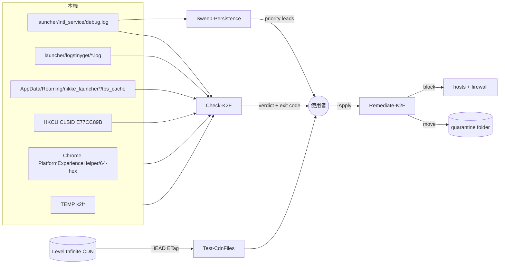

# 開發文件

給想看懂、驗證或修改這套腳本的人。所有痕跡與數值的來源在 [FACTS.md](FACTS.md)。

## 結構

```text
nikke-k2f-check/
├── Check-K2F.ps1            只讀偵測：第 1／2 階段痕跡、時間線、判定
├── Remediate-K2F.ps1        處置：預設試跑，-Apply 才動手，一律隔離不刪
├── Sweep-Persistence.ps1    只讀：木馬活動時段內新增的自動啟動項與未簽章檔案
├── Test-CdnFiles.ps1        只送 HEAD：比對 4 個 CDN 檔案的 ETag
├── README.md / README.en.md
├── AGENTS.md                給 AI 代理的事實與步驟
├── llms.txt                 機器索引
└── docs/
    ├── FACTS.md             事實清單（單一來源）
    ├── DEVELOPER.md         本文件
    ├── index.explainer.json 玩家說明頁的內容檔
    ├── index.html           由內容檔產生的說明頁（GitHub Pages）
    └── assets/
        ├── build_hero.py    重新產生 hero.png
        └── hero.png
```

## 資料流



## 判定邏輯

`Check-K2F.ps1`：

| 判定 | 條件 | exit code |
|---|---|---|
| infected-live | 有 RED，且至少一筆不在 `debug.log` / `tinyget` 底下（元件仍在） | 3 |
| infected-history | RED 全部只在 `debug.log` / `tinyget`（處理後保留的紀錄） | 2 |
| contact | 只有 YELLOW | 1 |
| clean-known | 沒有任何發現 | 0 |

- 字串比對一律讀位元組（Latin-1 一對一解碼），同時比 ASCII 與 UTF-16LE。原因：leveldb 與 Code Cache 是二進位檔，`Select-String` 在實測機上漏抓 `k2f.agent.state`。
- `agent_pass` 不會印出，也不寫進報告。

`Sweep-Persistence.ps1` 的木馬活動時段：從每筆 `agent started as` 起算，到那次啟動器最後一筆 `debug.log` 紀錄（間隔超過 1 小時視為下一次啟動）再加 30 分鐘，上限 `-WindowHours`（預設 8）。木馬住在啟動器的網頁元件裡，啟動器關了它就停，所以用固定 8 小時會把之後裝的正常軟體也算進去（實測：從 575 項降到 0 項優先項目）。已有效簽章的程式檔不列入。

## 驗證

在一台已知中毒的港澳台版電腦上（2026-11-04）：

| 檢查 | 結果 |
|---|---|
| 正向對照：Check-K2F 對中毒機 | 抓到 debug.log 三行、3 個 tinyget 紀錄、`k2f.agent.state`（c2s_counter=5）、Code Cache 接觸 |
| 負向對照：Check-K2F 對乾淨的假安裝資料夾（只有 `FETCH_LIST suc success`） | 安裝資料夾類發現 0 筆 |
| 處理後重跑 | 判定由 infected-live 變為 infected-history |
| Remediate 邊界：`-InstallPath C:\` 試跑 | 沒有列出任何不相關的程序 |
| Test-CdnFiles（台灣，約 15:00） | 4 個檔案都是乾淨 ETag |
| 4 支腳本 PowerShell 5.1 解析 | 0 個語法錯誤 |

沒驗證過：國際版與日版的安裝資料夾結構、Proton/Linux、第 2 階段的正向對照（實測機沒有第 2 階段痕跡）。

## 手動驗收清單

A 必驗
1. 在你自己的 PowerShell 視窗跑 `Check-K2F.ps1`，最後一行有出現四種判定之一。
2. `Remediate-K2F.ps1` 不加 `-Apply` 時，輸出每一行都是 `[would]` 或「沒有…」，沒有任何東西被搬走。
3. 加 `-Apply` 後，隔離資料夾裡有 `nikke_launcher*-tbs_cache` 與 `launcher-logs`。
4. 處理後重跑 `Check-K2F.ps1`，判定不再是「木馬元件仍在」。

B 體驗
1. 玩家說明頁在手機寬度下，指令區塊能左右捲動、複製按鈕可用。
2. 沒碰過 PowerShell 的人照說明頁四個步驟能跑完檢查。

## README 流程圖的節點對照

| 圖上的節點 | 對應 |
|---|---|
| 檢查 Check-K2F / 再檢查一次 | `Check-K2F.ps1`；說明頁「四個步驟檢查」 |
| 用手機換密碼與金鑰 | 說明頁「中了之後的處理」第一步；FACTS「木馬會偷的東西」 |
| 處理 Remediate-K2F | `Remediate-K2F.ps1` 步驟 1–5 |
| 重新開機後再跑一次 | `Remediate-K2F.ps1` 第 3 步 dll 被鎖住的提示 |
| 後門掃描 Sweep-Persistence | `Sweep-Persistence.ps1`；說明頁「沒辦法重灌的話」 |
| 比對官方檔案 Test-CdnFiles | `Test-CdnFiles.ps1`；FACTS「被竄改的官方檔案與指紋」 |
| 可以再開啟動器 | 說明頁「什麼時候可以再打開啟動器」 |

流程圖由 GitHub 自動排版，沒有做幾何檢查；省略的部分：攻擊者側的流程、第 2 階段的內部機制。

## 限制

- 只找已知痕跡。木馬有 `exec` 指令，可能放了這裡沒列出的東西；`Sweep-Persistence.ps1` 只列線索，不做判定。
- 第 2 階段讀 HKCU 與 `%LOCALAPPDATA%`。在 MSIX 包裝 App（例如某些 AI 桌面工具）內建的終端機裡，這兩處可能被虛擬化，結果與使用者自己的視窗不同；以自己開的 PowerShell 視窗為準。
- ETag 比對只看你連到的那個 CDN 節點，多查幾次才有意義。乾淨 ETag 來自 MotherSphere 的公開整理，若官方之後再更新檔案，會顯示「未知」。
- 處置需要系統管理員權限才能改 hosts 與防火牆；沒有權限時那一步會略過並列為未完成。
- `Sweep-Persistence.ps1` 大約要跑 2–3 分鐘（實測機 171 秒）。

## 改這套工具

- 新增或修改痕跡：先改 [FACTS.md](FACTS.md)（附來源），再改腳本。
- 說明頁只改 `docs/index.explainer.json`，再用 html-explainer carrier 重建 `docs/index.html`；不要手改 HTML。
- `.ps1` 必須存成 UTF-8 with BOM、CRLF（PowerShell 5.1 讀中文需要 BOM）。
- 重新產生 hero 圖：`python docs/assets/build_hero.py`（需要 Playwright）。
